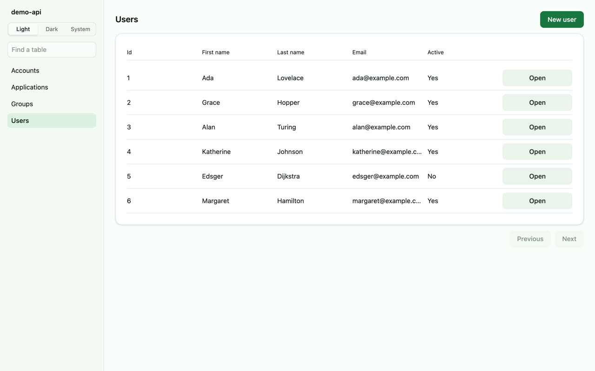

========

[](https://badge.fury.io/js/generaptr) [](https://badge.fury.io/js/generaptr-cli) [](https://github.com/generaptr/generaptr/actions/workflows/ci.yml) [](https://gitter.im/generaptr/generaptr?utm_source=badge&utm_medium=badge&utm_campaign=pr-badge&utm_content=badge) [](https://coveralls.io/github/generaptr/generaptr?branch=master)
[](https://app.fossa.io/projects/git%2Bgithub.com%2Fgeneraptr%2Fgeneraptr?ref=badge_shield)

Generaptr reads the tables of a MySQL or PostgreSQL database and writes three things:

- A REST API: Express 5, Drizzle ORM, and zod validation, with one CRUD route per table.
- An OpenAPI 3.1 document that describes that API exactly.
- A web app for that API: list, detail, create, and edit pages per table, drawn with shadcn components and Tailwind.

Generaptr can also read an OpenAPI document back and write the API from it.

```sh
npx generaptr-cli
```

| Package | Path | Use it to |
|---|---|---|
| [`generaptr-cli`](packages/cli) | `packages/cli` | Answer prompts and get an API or a spec. |
| [`generaptr`](packages/core) | `packages/core` | Call the same steps from your own code. |

Both packages need Node 22 or later. They release together with the same version.

## The generated API

```
api/
├── package.json        # express, drizzle-orm, the driver, zod (exact versions)
├── drizzle.config.js
├── .env.example        # DATABASE_URL
├── openapi.json
├── scripts/
│   └── baseline.js     # npm run db:baseline
└── src/
    ├── index.js
    ├── app.js          # mounts one router per table
    ├── db/
    │   ├── index.js
    │   ├── schema.js   # one Drizzle table per database table
    │   └── relations.js # both sides of every foreign key
    └── routes/
        └── <table>.js  # list, get, create, update, delete
```

- Each table with one primary key gets `GET /<table>`, `POST /<table>`, `GET|PUT|DELETE /<table>/{id}`. Link tables with a composite key get no routes.
- The list route takes `limit` (at most 100, default 20) and `offset`.
- The list and get routes take `with` to include related rows, for example `GET /users/1?with=accounts,groups`. A foreign key `accounts.user_id` gives `accounts.user` and `users.accounts`. A link table, such as `users_groups`, gives `users.groups` and `groups.users`. A nested list returns at most 100 rows. `with` reaches only tables that have routes, and an unknown name gets 400.
- zod schemas from `drizzle-orm/zod` check request bodies. A bad body gets 400 with the zod issues.
- Database errors get a generic 500. The response does not show the database message.
- Column defaults from the database stay in the schema, so a client can leave those columns out.

Run it:

```sh
cd api
cp .env.example .env    # then set DATABASE_URL
npm start
```

## The generated web app

```
web/
├── package.json        # react, vite, tailwindcss, @json-render/* (exact versions)
├── vite.config.js      # forwards /api to API_URL
├── .env.example        # API_URL, default http://localhost:3000
└── src/
    ├── pages.json      # json-render specs, written from openapi.json
    ├── main.jsx        # renders the specs; the same for every API
    ├── theme.css       # colors and radius for light and dark mode
    └── index.css       # Tailwind setup
```



- Each table with a route gets a list page with paging, a detail page with its related rows, and create and edit forms.
- `src/pages.json` holds one [json-render](https://github.com/vercel-labs/json-render) spec per page. Edit it to change a page; generate again to start over.
- A form takes its fields from the API's input schema. A foreign key becomes a select of the rows it can point to. The form checks required fields and lengths, and shows the API's message when the API rejects a row.
- A switch in the sidebar sets light mode, dark mode, or the system mode. To change the colors, edit `src/theme.css`, or paste a theme from [ui.shadcn.com/themes](https://ui.shadcn.com/themes).
- The browser calls `/api` on the web app's own server, which forwards to the API, so the API needs no CORS.

```sh
cd web
cp .env.example .env    # then set API_URL
npm run dev             # or: npm run build && npm run preview
```

### Migrations

The generated API uses Drizzle Kit migrations. Migrations go forward only. To undo a change, write a new migration.

```sh
npm run db:generate     # writes SQL from src/db/schema.js
npm run db:migrate      # applies the SQL
```

> [!IMPORTANT]
> On the database that generaptr read, run `npm run db:baseline` once, before the first `db:migrate`. It writes the first migration and records it as applied without running it, because those tables exist there already. A new, empty database skips this step: `db:migrate` creates the tables.

```sh
npm run db:baseline     # once, on the database that generaptr read
```

## Supported column types

| MySQL | PostgreSQL |
|---|---|
| `tinyint`, `smallint`, `mediumint`, `int`, `bigint`, `year` (signed or `unsigned`) | `smallint`, `integer`, `bigint`, serial and identity columns |
| `tinyint(1)` as boolean | `boolean` |
| `decimal(p,s)` | `numeric(p,s)` |
| `varchar(n)`, `char(n)` | `character varying(n)`, `character(n)` |
| `enum(...)` | enum types (`CREATE TYPE ... AS ENUM`) |
| text types, `date`, `datetime`, `timestamp`, `time` (with fractional seconds), `json`, `float`, `double` | `text`, `date`, `time`, `timestamp` with or without time zone and precision, `json`, `jsonb`, `uuid`, `real`, `double precision` |
| | One-dimensional arrays of the types above, for example `text[]` |

Binary types (MySQL `binary`, `varbinary`, and blob types, PostgreSQL `bytea`) carry base64 strings in JSON. Any other type, for example `tsvector`, `inet`, `money`, `bit(3)`, MySQL `set(...)`, or a multi-dimensional array, becomes a Drizzle custom type with the exact SQL type.

Generaptr stops when a table or column name has characters other than letters, digits, and `_`.

## What the generated schema keeps

`src/db/schema.js` rebuilds the database that generaptr read. A test in this repository rebuilds a schema from it and compares the catalogs of both databases.

- Primary keys, unique constraints, and foreign keys with their names, composite columns, and `ON DELETE` and `ON UPDATE` actions.
- CHECK constraints.
- Indexes: method, column and expression keys, collation, operator class, order, `NULLS FIRST` or `LAST`, `WHERE`, storage parameters, and MySQL prefix lengths.
- Defaults, generated columns, identity columns with their sequence options, column collations, and MySQL `ON UPDATE CURRENT_TIMESTAMP`.
- PostgreSQL enums and sequences, also the ones that no column uses.

## Known limits

Drizzle cannot write these, so generaptr stops with an error when a schema has one:

- PostgreSQL `INCLUDE` columns on an index, unique indexes with `NULLS NOT DISTINCT` (unique constraints with it work), exclusion constraints, virtual generated columns, and sequences of a type other than `bigint` that no column owns.
- MySQL `FULLTEXT` and `SPATIAL` indexes, and `enum` or `set` values with a backslash.

Other limits:

- Generaptr reads one PostgreSQL schema (`public` by default). Views, functions, triggers, and comments are not read.
- A serial column keeps the default options of its sequence.
- The generated API pins `drizzle-orm` and `drizzle-kit` `1.0.0-rc.5`, a release candidate.

## Upgrade from 2.x

- Keys belong to the table: `DbTable` has `primaryKey`, `uniques`, and `foreignKeys`. `DbColumn` has no `primary`, `unique`, or `references`. Generaptr 2 OpenAPI documents still read.
- A PostgreSQL identity column reads as `DbColumn.identity`, not as `autoIncrement`.
- MySQL `binary`, `varbinary`, and blob columns carry base64 strings in the generated API.
- Generate the API again. Then run `npm run db:generate` to see the difference between the old schema and the new one.

## Contributing

See [CONTRIBUTING.md](CONTRIBUTING.md) and the [Code of Conduct](CODE_OF_CONDUCT.md). Changes per release are in [CHANGELOG.md](CHANGELOG.md).

## License

MIT. See [LICENSE](LICENSE).

[](https://app.fossa.io/projects/git%2Bgithub.com%2Fgeneraptr%2Fgeneraptr?ref=badge_large)
